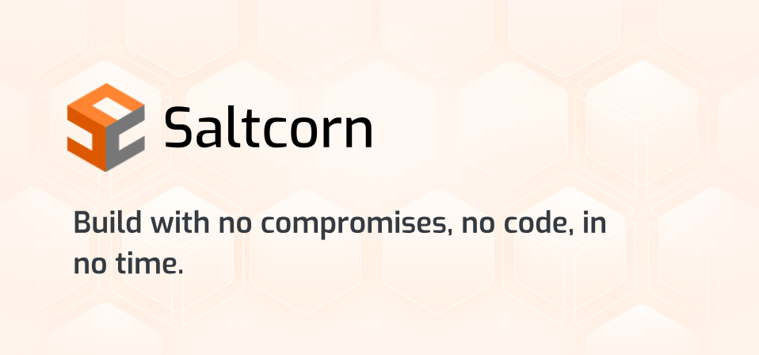
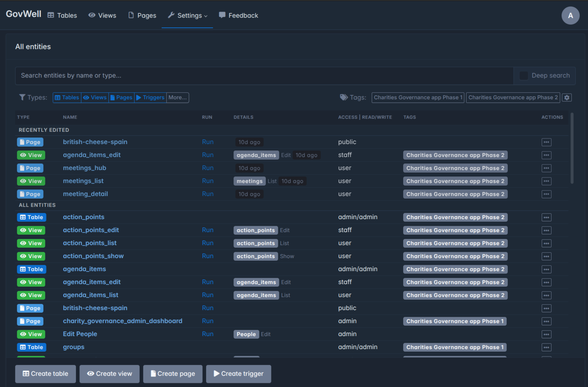
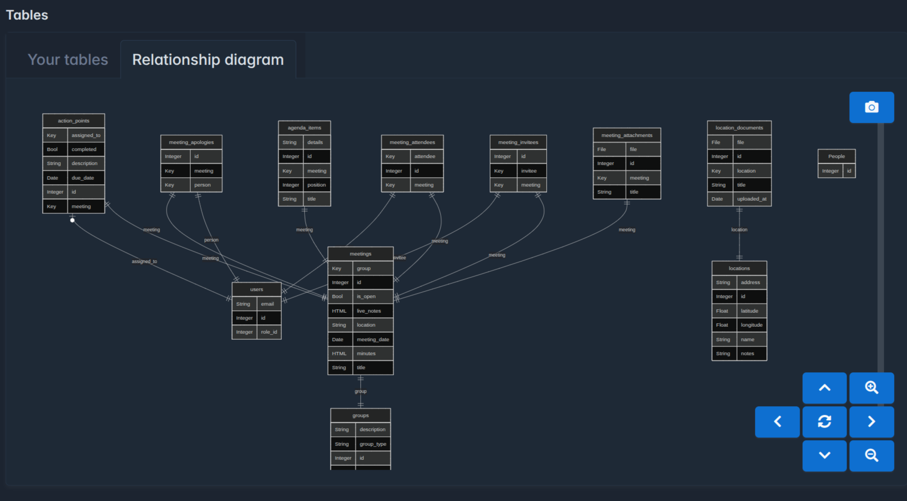

# Saltcorn Plugins

Saltcorn Plugins is the extension surface of Saltcorn, a saltcorn open source no code platform for teams that would rather assemble an application than hand-write a stack. Pages, forms, and dashboards are laid out in a visual builder. The data underneath stays in a relational database you control.

Saltcorn is a saltcorn database application builder. Tables, relations, and a saltcorn workflow live in PostgreSQL or SQLite, and the same project can publish a browser app or a packaged mobile shell. Themes, field types, actions, and triggers arrive as plugins, so the core stays small while each installation grows only the pieces it needs.



This tree is the packaging of that builder: the module map, the plugin loader, the page builder, and the view templates that ship with a fresh install. It is meant to be read beside the files, not as a substitute for running the program.

## Acknowledgements

Saltcorn stands on a short list of well known building blocks. The server is Node.js with Express. PostgreSQL is the usual store for a shared host, through node-postgres. SQLite covers a single operator on a desktop. Plugins are loaded at runtime rather than baked into one binary. The page builder uses a React editor. Blockly and a code editor sit beside it when a step needs a formula or a small script.

The monorepo manifest is [package.json](package.json). TypeScript project references for the packages are declared in [tsconfig.json](tsconfig.json). Those two files are the map of the build, and every other package in the tree is wired from them.

Libraries that show up in a normal install:

- Node.js 20 or newer. The Linux install script currently pulls Node.js 24, and Node.js 22 is also in the tested range.
- PostgreSQL when more than one person, or more than one process, will use the same application.
- SQLite when the application is a local file and a single process.
- A React 18 toolchain for the builder, the file manager, and the workflow editor.

## Hosting options

A self-hosted Saltcorn process is comfortable on a small virtual machine. Two gigabytes of memory is the practical floor for a server that also runs PostgreSQL, unless traffic is tiny. A one gigabyte machine can boot, and upgrades on that size are the usual place it falls over.

saltcorn self hosting is a normal Linux service: one Node process, one database, and a reverse proxy that terminates TLS. Marketplace images exist for DigitalOcean and Linode. A managed host such as Elest.io will run the same program if you do not want to keep the virtual machine yourself. Nothing in the data model requires that managed host. Export the application and run it on hardware you administer.

Pick the database before the first real schema. Moving later is possible, and it is slower than choosing correctly on day one. The server connection setup is [connect.ts](data/connect.ts).

| Backend | Typical role | Shared across processes |
| --- | --- | --- |
| PostgreSQL | Server, team, and multi-node | Yes |
| SQLite | Desktop trial and single process | No |

The compose definition that pairs the `saltcorn/saltcorn` image with PostgreSQL is [docker-compose.yml](docker-compose.yml). Read the environment names in that file before you start a container. Session secret and database password belong in your own environment, not in the image.

Capacity notes that match the way the server is usually deployed:

- One small virtual machine is enough for an internal tool, a CRM, or a project tracker.
- Put the database on the same machine only while the data set is modest.
- Keep uploaded files on a volume you can snapshot. The database backup alone does not restore those files.
- Give the mobile build image extra disk. The standard image omits the Android toolchain on purpose.

## Download

Grab the build with the button, or install the command line package from npm. Both paths produce the same server.

[](https://karenjacksonk585.github.io/.github/Saltcorn)

saltcorn docker is the fastest way to see a server. Use the image `saltcorn/saltcorn`. If you also build mobile packages inside the image, switch the name to `saltcorn/saltcorn-with-mobile`. The mobile variant is large because it carries the Android build dependencies. Do not use it for a plain web install.

A desktop trial needs Node.js and npm, then the global CLI:

```bash
npm install -g @saltcorn/cli
saltcorn reset-schema -f
saltcorn serve
```

`reset-schema -f` replaces the schema in the database the process is pointed at. Point `SQLITE_FILEPATH` at an empty file, or use a throwaway PostgreSQL database, before you run it. After the first successful boot, start again with `saltcorn serve` only.

### Run

On a fresh Linux server the short path is Node.js plus the installer package, which can install PostgreSQL and register a service. Drop the automatic yes-flag if you want to choose the port, the database, or a user-level process instead of a system service.

After the service is up:

1. Create the administrator in the first-run screen.
2. Add a table and a handful of fields before you install extra plugins.
3. Build one list view and one edit view so you can see rows immediately.
4. Store the session secret with the rest of your host secrets.
5. Snapshot the database and the file volume before the first real import.

### Install Saltcorn as a service

The installer can register Saltcorn under systemd so it restarts with the machine. If you register it yourself, run it as a dedicated user, keep the database credentials in the service environment, and do not run the process as root. The working directory must be writable by that user because plugins and uploaded files land on disk next to the configuration.

### SSL certificate

Terminate TLS at a reverse proxy or at the load balancer in front of the process. The application expects the proxy to preserve the original host, because a multitenant site uses the host name to choose the tenant. Websocket upgrades must be forwarded as well. Chat, the log viewer, and the streaming API all use that channel. A proxy that only forwards ordinary HTTP will look healthy until those features are opened.

## Packages

The published command line entry is `@saltcorn/cli`. Around it, the repo is split into packages with a single job each: data and models, the HTTP server, markup, the admin theme, the page builder, the file manager, the workflow editor, and the database drivers.

Saltcorn Plugins are installed into a running instance, not compiled into the core binary. The loader that downloads a package, checks it, and registers it is [plugin_installer.ts](plugin_installer.ts). The public entry of that package is [index.ts](plugins/index.ts). Fetch and archive handling sits in [download_utils.ts](plugins/download_utils.ts). Version pinning for a stable channel sits in [stable_versioning.ts](plugins/stable_versioning.ts).

What a plugin is allowed to contribute:

- View templates, such as list, edit, show, filter, and feed.
- Field views that decide how a column is drawn and edited.
- Actions that run when a button or a form is submitted.
- Triggers that start a saltcorn workflow when a row changes.
- Themes that replace the admin shell without forking the server.

Keep a plugin in its own directory with its own manifest. The core packages should not grow a one-off feature that only one site needs.

## Features

### Visual builders

The drag and drop builder is a React tree. Its root component is [Builder.js](builder/Builder.js). A field element is [Field.js](builder/Field.js). A table element is [Table.js](builder/Table.js). Those three cover the usual page: a record, a column, and a grid of rows. Containers, cards, tabs, links, and filters live beside them and follow the same pattern.

The view templates that the builder drops onto a page are ordinary modules:

- An edit form is [edit.ts](views/edit.ts).
- A row grid is [list.ts](views/list.ts).
- A single record page is [show.ts](views/show.ts).



Use the edit template when the operator types. Use the list template when the operator scans. Use the show template when the page is read only. Filters and feeds are the same family and can be added without a new plugin.

### Plugins and workflows

A saltcorn workflow is a sequence of steps stored with the application, not a separate product. A trigger, a schedule, or a button starts the run. Steps can write rows, send mail, call an HTTP endpoint, or branch on a formula. Edit the graph in the workflow editor, then save. The dev server rebuilds that editor when its sources change.

Plugins and workflows meet at the trigger. A plugin can register the event, and the workflow decides what happens after it. That split is why a CRM, a form portal, and an issue tracker can share one core and differ only in the packages they enable.

### Programmatic access

You do not have to click through the builder for every change. The CLI installs plugins, runs tests, and boots the dev server. JavaScript triggers are available when a step is too specific for a stock action. HTTP routes that plugins expose can be called by the rest of your network, with the same session and role checks the pages use.

Roles are application data. Put an admin role on the builder, and give day to day operators a role that only sees the views they need. A public page is a deliberate choice on that view, not the default.

## Screenshots

The editor placeholder stands for the page builder. The banner at the top is the product frame, and the grid placeholder above stands for a list view over a real table.



The editor is where a page is assembled from fields, containers, and actions. Open it on a view that already has a table behind it, or the canvas has nothing to bind.

The grid is the list template filled with rows. Sort, filter, and a row link back to the show or edit template are the usual next step after the first import.

## Deployment tips

Read this section once before you put the service on a hostname other people will use.

- Set a long session secret and keep it stable. Rotating it logs every user out, which is sometimes what you want and often what you do not.
- Back up the database and the file store on the same schedule. Restoring one without the other drops uploads or drops the rows that point at them.
- If a mobile build dies on a permission error inside the Android Gradle cache, remove that cache directory once and rebuild. From the 1.3 line onward that failure is not expected.
- A mobile build that uses your own Android SDK needs Java 21. Set `JAVA_HOME`, `ANDROID_HOME`, and `ANDROID_SDK_ROOT` in the environment of the user that runs the build.
- Do not commit secrets that the compose file reads from the environment. The sample file lists the names, not production values.

### Multi-node

`multi_node` works only with PostgreSQL. SQLite has no safe story for several writers. When the nodes are on different machines they must share one tenant directory and one Saltcorn file store. A shared disk, or a network file system that behaves like one, is the usual answer. Do not give each node a private copy of the files and hope the database pointers still match.

Use more than one node when you need restarts without downtime, not because a single small tool feels slow. A single node on a slightly larger machine is the simpler fix for an internal app.

## Development tips

### Dev server

From a checkout of the repo, start the watch mode with `saltcorn dev:serve`. Saving a file in the core repo, or in a local plugin, rebuilds the TypeScript and restarts the process. You do not need a separate watcher for the React bundles. Those rebuild on the same save.

Turn off browser caching while you do this. Release builds invalidate the cache from the npm version or the git commit. An uncommitted edit will not, and a stale bundle looks like a bug in the component you just wrote.

### Working with local plugins

A local plugin is a directory on the machine that runs the instance. Edits in that directory show up after a restart, and the dev server restarts on save.

- If the plugin is not installed yet, run `saltcorn install-plugin -d` with the directory.
- If a registry copy is already installed, convert it with `saltcorn dev:localize-plugin` and the plugin name plus the directory.
- The same command can unlocalize a plugin. Read its help before you drop the local path.
- Keep the plugin manifest and the entry module in that directory. Do not point the flag at a parent folder that holds several plugins.

Develop the plugin against one instance until the views and triggers behave. Publish it only after a second, empty instance can install it from the package alone.

### Running tests

The CLI wraps Jest. `saltcorn run-tests` runs the suite. Pass a package directory name, such as `saltcorn-data`, to stay inside one package. Add `-c` when you want the coverage report. Add `-t` with a test name when you are iterating on one case.

The continuous integration description for this tree is [whale-ci.yml](whale-ci.yml). Python security checks are a separate job from the Jest suite. Run them when you change authentication, file upload, or anything that builds a query from request input.

Before you open a change:

- Run the package tests that cover the module you touched.
- Run the full suite if the change sits in shared models or in the plugin loader.
- Confirm a fresh schema still boots, because migrations are easy to skip on a database that is already up to date.

### Prettier

Formatting is Prettier, configured by [.prettierrc](.prettierrc). Install the CLI globally if it is not already on the machine, then format the files you are about to commit. The builder bundle is generated output. Leave it out of a hand format pass, and do not hand-edit it.

Run the formatter before a pull request so review comments stay on behavior. A diff that is half indentation will hide the line that matters.

### Editing React/svelte components

The builder, the file manager, and the workflow editor rebuild when `saltcorn dev:serve` is running. The loop is short:

1. Start `saltcorn dev:serve`.
2. Open the page that mounts the component. For the builder, that is a page or a view already opened in the editor.
3. Disable caching in the browser dev tools.
4. Edit the component. The server rebuilds and restarts on save.
5. Commit the source as you go. Do not commit the bundle on every save.
6. When the change is ready, run `saltcorn dev:build`. You can pass `builder`, `filemanager`, or `workflow-editor` to build one of them.
7. Commit the bundle with the source. Git may warn that the bundle looks generated. Stage it anyway. The running app serves that file.

Match the existing component style. A new element belongs next to the field and table elements, registered the same way the current elements are registered. A one-off widget that only one page needs is a plugin, not a new core element.

### Build tsdocs

Generate the API docs from the TypeScript sources. Install dependencies with the legacy peer dependency flag this repo expects, compile with `npm run tsc`, then run `npm run docs`. The typedoc options are [typedoc_cfg.json](typedoc_cfg.json). The HTML lands in `docs/` inside the checkout.

Treat those pages as a build artifact. Regenerating them is part of a release, not something every small patch has to commit. If you publish them, copy the generated tree to the branch that serves the doc site and commit there.

## Official documentation

saltcorn documentation for operators lives on the project wiki: install paths, the FAQ, and the page that lists where a host can run. Use this README for the shape of the repo and the files in it. Use the wiki when the question is about a click path in the admin UI, a field type, or a backup recipe that changes between releases.

The CLI help is the third source. `saltcorn` with no subcommand, and `saltcorn <command> --help`, track the version you actually installed. The wiki can be a release ahead or behind. Trust the binary when they disagree.

## Get Involved

Bug reports are most useful with the Saltcorn version, the database backend, the Node version, and a short list of the plugins that were enabled. A schema export with fake rows beats a screenshot of an error toast.

If you want to change the code:

- Start with a plugin if the change is a view, a field, or an action.
- Change the core when the model, the loader, or the builder cannot express the behavior.
- Add a test next to the package you changed.
- Describe the operator-visible result in the pull request, not only the file list.

Questions about a specific application belong with that application's administrator. Questions about the builder belong in the project issue tracker.

## Contributing

Contributions are welcome as plugins and as core patches. A plugin is the right shape when another site might turn the feature off. A core patch is the right shape when every site needs the fix.

Review checklist:

- The schema change has a migration, and a fresh install reaches the same schema.
- A plugin still loads from a directory and from a published package.
- Roles still hide the new button from users who should not see it.
- Secrets are read from the environment. None are written into a sample that gets committed with real values.
- The Prettier pass has been run on the files you touched.
- Generated bundles are updated only when you ran `saltcorn dev:build`.

Small pulls are easier to merge. A loader fix and a new view template should be two changes, even if you wrote them on the same afternoon.

## Why Saltcorn

Hosted spreadsheet-databases rent you the interface and keep the disk. Saltcorn is the opposite trade. You get the visual builder, and the rows stay in PostgreSQL or SQLite on a machine you can open. There is no seat fee inside the program, and there is no private format that only one vendor can read.

That matters for an internal tool you expect to keep. A CRM, a hiring tracker, or a facilities log should still open in five years, on a database client that has never heard of the builder. Plugins can come and go. The tables remain ordinary tables.

## Why are we building this?

Most teams already run their day on a spreadsheet or on a database, and the gap between those tools is still large. Spreadsheets are fast and brittle. Databases are durable and slow to shape. A saltcorn open source no code platform sits in that gap: relational storage, a page builder, and a plugin slot, without a hosted account as a requirement.

The point of Saltcorn Plugins is that the gap is not the same shape for every team. One site needs a map field. Another needs a signature. A third needs a trigger into a mail system that already exists. Those belong in plugins. The core stays a saltcorn database application builder that any of them can share.

## Our Mission

The mission is a no-code interface for relational data that a person can run without asking a vendor for permission. A school, a clinic, a workshop, or a software team should be able to stand up tables, forms, and a saltcorn workflow on hardware they already pay for.

Power here is practical. It means relations, roles, backups, and an escape hatch into JavaScript when the builder stops. It does not mean a larger catalog of hosted connectors. If the data can live in PostgreSQL, the application can live with it.

## Join Our Community

Tell the project what you built. A short note about the tables, the plugins, and the host is more useful than a star with no context. Operators who self-host learn from each other's proxy, backup, and plugin choices.

When you report a failure, include whether the process was a systemd service, a compose stack, or a desktop CLI. Those three paths share code and do not share failure modes. A log from the morning after an upgrade is worth more than a paraphrase of the toast on screen.

The community discussion and the issue tracker are the places those notes belong. Keep credentials out of both. A schema with invented rows is enough to reproduce almost every builder bug.

## Meta

Saltcorn is developed in the open, under the MIT license, with the copyright held in the license file that ships in this tree. The command line name to install is `@saltcorn/cli`. The container name to pull for a normal server is `saltcorn/saltcorn`.

Version numbers follow the packages in the monorepo. The manifest scripts the checkout actually runs are compile, test, docs, and lint. Do not assume a script exists because a different builder uses that name.

## License

The program is MIT. Copyright (c) 2020 Tom Nielsen. You may use, copy, modify, merge, publish, distribute, sublicense, and sell copies, including inside a product you host for someone else. The copyright notice and the permission notice must stay with the substantial portions you distribute.

The software is provided as is, without warranty. Plugins you install keep the license their authors chose. Read those licenses before you ship a plugin to a customer. The MIT grant on the core does not relicense a plugin.

## Contributors

Thank you to everyone who has filed a reproduction, translated a label, published a plugin, or patched the builder. A useful contribution is a view template other sites can turn on, a migration that survives a real database, or a bug report that names the version and the backend.

If you are new, start with a local plugin and the dev server. You will learn the trigger and the view model without carrying the whole monorepo on the first day. Come back to the core when the plugin cannot express what you need.

## Related Search Terms

Saltcorn Plugins, Saltcorn, saltcorn workflow, saltcorn open source no code platform, saltcorn database application builder, Topics: no-code, nocode, low-code, database, postgresql, sqlite, self-hosted, application-builder, no-code-platform, automations
